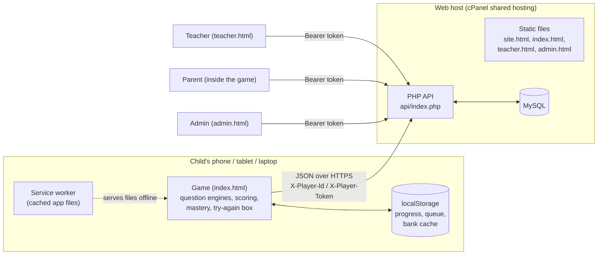

# Architecture

## The big picture

BrainSprint is two programs:

- a **frontend** (`frontend/`): Vue 3 + TypeScript + Tailwind, built with Vite. It contains the whole game,
  including every question engine, and runs on the child's device;
- an **API** (`api/`): plain PHP 8 that answers JSON requests, backed by a MySQL (or MariaDB) database.

The game is **offline-first**: everything a child does during play happens on the device. The API is only needed to
share results (leagues, friends, schools, parents, teachers) and to download human-written bank questions.



## One Vite project, four web pages and an Android app

`frontend/vite.config.ts` builds several HTML entry pages from one code base:

| Page | Entry | Who it's for |
|---|---|---|
| `index.html` | `src/main.ts` → `App.vue` | The game itself (children; parents use a section inside it) |
| `site.html` | `src/site/main.ts` | The public landing page for parents and schools; the site's front page |
| `teacher.html` | `src/teacher/main.ts` → `TeacherApp.vue` | Teachers: classes, homework, question suggestions |
| `admin.html` | `src/admin/main.ts` → `AdminApp.vue` | Staff: overview, schools, players, enquiries, question bank |

All four share `src/game/` (so the teacher portal can list the same topics the game produces) and
`src/shared/` (CSV parsing and the question editor used by both admin and teachers).

Build modes:

| Command | Mode | API address (`VITE_API_URL`) | Pages |
|---|---|---|---|
| `npm run dev` | development | `/brainsprint/api`, proxied to XAMPP's Apache | all |
| `npm run build` | production | `/brainsprint/api` (default in the code) for local XAMPP | all |
| `npm run release` | `live` | from `.env.live`, normally `/api` | all, packaged with the API |
| `npm run build:android` | `android` | from `.env.android`: a full `https://…/api` address | `index.html` only, no service worker |

The **Android app** is the same game wrapped by **Capacitor** (`capacitor.config.ts`, app id
`com.brainsprint.kids`). Capacitor puts the built web files inside a native Android shell; the game runs in the
phone's WebView. `src/lib/native.ts` adds the few phone-only behaviours (status bar colour, splash screen, the
Android back button) and does nothing on the web. The Android build needs Java 21 (see
[decision 13](decisions.md#adr-013-java-21-for-android-builds)).

`base: './'` makes every built path relative, so the same files work at a web root, in a sub-folder
(`/brainsprint/frontend/dist/`) and inside the app. The game uses **hash routing** (`#/league`), which needs no
server rewrite rules and works the same in a WebView ([decision 14](decisions.md#adr-014-hash-routing)).

## Offline-first

**Saved on the device.** The player store (`src/stores/player.ts`) keeps everything in one `localStorage` key,
`bsk:v1`, and writes it after every change: profile, total points, stars per level, badges, Brain Power, day streak,
recent question keys, topic mastery, the try-again box, the mock history and two **queues** of results waiting to be
uploaded (`pending` sprints and `pendingMocks`). Other keys: `bsk:settings` (sound, read-aloud), `bsk:parent` (a
parent's sign-in token) and `bsk:bank:<subject>:<grade>` (downloaded bank questions).

**Sync.** `sync()` runs when the app opens, after every sprint and before league requests. It registers the device
if needed, then uploads the queues one item at a time, oldest first. Each item is removed only after the server
accepts it.

| Server answer | What the app does |
|---|---|
| Success | Remove the item, keep the returned XP summary |
| 401 (token not recognised, e.g. the database was reset) | Forget the token; register again next time |
| 422 (refused, e.g. failed an anti-cheat check) | Drop that one item so the queue isn't blocked forever |
| No connection / server error | Keep everything; try again later |

Because the server accepts the same sprint (same player and `played_at`) only once, retrying after a dropped
connection never double-counts.

**Service worker (PWA).** On the web, `vite-plugin-pwa` (Workbox) generates `sw.js`, which pre-caches the game's
files (JS, CSS, HTML, images, fonts) so the game opens and plays with no connection, and makes the site installable
("Add to Home screen") from `manifest.webmanifest`. It updates itself automatically (`registerType: 'autoUpdate'`).
Staff pages (`admin.html`, `teacher.html`) are never cached on children's devices, and requests to `/api/` are never
answered from the cache. Apache headers (`frontend/public/.htaccess`) keep HTML and the service worker files fresh
(`no-cache`) and let the fingerprinted files in `assets/` be cached for a year. The service worker is disabled in
the Android build, which already ships every file.

**Works without a server at all.** Questions are generated on the device, Brain Power is computed from timestamps,
mastery and reviews are local. Without a connection a child can do everything except leagues, friends, schools,
races, the boss board and parent/teacher features. Fonts are bundled (`@fontsource/fredoka`) for the same reason.

## How the frontend talks to the API

`src/lib/api.ts` is a thin `fetch` wrapper. Every request is JSON; errors come back as `{ "error": "message" }` with
an HTTP status, turned into an `ApiError` (status `0` means no connection).

| Who | How they prove who they are |
|---|---|
| **Child** (a device) | `X-Player-Id: 123` and `X-Player-Token: <64 hex chars>` |
| **Parent** | `Authorization: Bearer <token>`, from phone number + 4-digit PIN |
| **Teacher** | `Authorization: Bearer <token>`, from phone number + password; tokens last 30 days |
| **Admin** | `Authorization: Bearer <token>`, from username + password; tokens last 12 hours, kept in `sessionStorage` |

A child never types a password. On first sync the device sends `POST /players` with a random `device_id` (a UUID
made on the device) plus name, avatar and class; the server creates or updates that player and returns a fresh
random token. Only the SHA-256 hash of any token is stored in the database, so a database leak doesn't leak working
tokens. Re-registering (e.g. after changing name or class) issues a new token and invalidates the old one.

Linking a child to a parent (`POST /parents/children`) needs **both** the parent's bearer token and the child's
player headers, which proves the parent has the child's device in hand.

`api/index.php` is a single front controller: `api/.htaccess` sends every request there, passes the
`Authorization` header through (some Apache setups drop it) and blocks direct access to every other `.php`, `.sql`
and `.md` file. The router is one `switch (true)` over `"METHOD /path"` strings and regular expressions; helper files
hold the logic by area. See [api.md](api.md) for every endpoint.

## Folder map

```
brainsprint/
  README.md, DEPLOY.md         how to run locally / put it online
  docs/                        this documentation
  content/                     question spreadsheets for the bank (CSV) and their format
  .htaccess                    localhost/brainsprint/ → frontend/dist/
  api/
    index.php                  every route (front controller)
    lib.php                    database, input checks, tokens, player/parent sign-in, Kampala weeks
    leagues.php                weekly league groups, promotion and demotion
    social.php                 presence, live feed, player cards, race ghosts, demo life
    community.php              friends, schools, the weekly boss
    learning.php               topic mastery, PLE mocks
    teachers.php               teacher accounts, classes, homework
    bank.php                   the question bank (validation, publishing, admin, teacher suggestions)
    admin.php                  admin sign-in, name filter, overview, contact form, public stats
    config.php                 default settings; real values in config.local.php (git-ignored)
    schema.sql, migrations/    database tables and later changes; migrate.php applies them
    dev/                       command-line tools: create-admin.php, seed-demo.php (local only)
  frontend/
    index.html site.html teacher.html admin.html    the four pages
    vite.config.ts             pages, PWA, dev proxy;  capacitor.config.ts  Android app
    scripts/                   check-questions, check-practice, release, copy-apk, make-icons
    public/                    icons, favicon, the .htaccess copied into dist/
    android/                   the Capacitor Android project
    src/
      game/                    pure TypeScript, no UI: question engines, sprint assembly, scoring,
                               practice, mock, boss, progress, badges
      stores/                  player.ts (all of a child's state + sync), parent.ts
      lib/                     api client, bank download, league live rank, clock, speech, sounds,
                               music, settings, native (Android) glue
      views/                   game screens (one per route)
      components/              shared UI (navigation, cards, Brain Power pill, parent gate …)
      teacher/ admin/ site/    the other three pages
      shared/                  CSV parser and question editor (admin + teacher)
  release/                     made by `npm run release`: upload package (git-ignored)
```

`src/game/` deliberately has no Vue code, so the Node test scripts (`check:questions`, `check:practice`) can run it
directly.

## Walk-through: a child finishes a sprint

```mermaid
sequenceDiagram
  participant C as Child
  participant S as SprintView
  participant P as player store
  participant L as localStorage
  participant A as API (POST /sprints)
  participant D as MySQL
  C->>S: opens P5 Maths Hard
  S->>S: makeSprint() avoiding the last 800 questions
  S->>P: startSprint(), rememberQuestions()
  S->>A: GET /league (for live rank), POST /presence
  loop 10 questions
    C->>S: taps an answer
    S->>S: pointsFor(), liveRank()
    S->>P: noteAnswer() → mastery + try-again box; spendPower() if wrong
  end
  S->>P: recordSprint(result)
  P->>L: save points, stars, badges, streak + queue the sprint
  P->>A: sync(): POST /sprints with X-Player-Id / X-Player-Token
  A->>D: checks, insert sprint, feed item, topic_stats, homework, XP, league XP
  A-->>P: XP summary (or keep queued if offline)
```

Step by step:

1. **Start.** `SprintView.vue` builds the questions with `makeSprint` (see [algorithms](algorithms.md#2-sprint-assembly)),
   counts the sprint for the day, remembers the question keys, fetches the league table for the live rank, tells
   the server what the child is playing (`POST /presence`) and, for a race, loads the rival's ghost. A 3-2-1
   countdown starts.
2. **Each answer.** A 100 ms timer runs the clock. On a tap (or timeout) the screen works out the points, updates the
   streak, calls `noteAnswer` (topic mastery and try-again box, saved on the device), spends Brain Power on a wrong
   answer, and checks whether the child just overtook someone. A wrong answer with worked steps pauses on
   "How to solve it".
3. **Finish.** `recordSprint` (player store) adds the points, keeps the best stars for the level, updates the day
   streak and daily goal, awards badges, and pushes a compact record onto the `pending` queue: subject, class,
   level, score, correct, total, average time, best streak, `played_at`, homework id, and per-topic counts
   (`{"fractions": [3, 4]}`). The state is written to `localStorage`. The screen moves to the results page; a race
   result and boss damage are sent separately.
4. **Sync.** `sync()` makes sure the device has a token (`POST /players` if not), then sends each queued sprint to
   `POST /sprints`.
5. **Server.** `api/index.php` checks the token, runs the [anti-cheat checks](algorithms.md#11-server-side-anti-cheat-checks),
   ignores a duplicate, inserts a `sprints` row, posts a feed item for a perfect 10 / big score / long streak (only
   if played in the last hour), updates `topic_stats`, records homework if it was homework, adds the score to
   `players.xp_total` and, if played this week, puts the child in a league group (`ensureMembership`) and adds the
   score to `league_members.xp`. It answers with the child's XP summary.
6. **Back on the device.** The summary is stored and the item leaves the queue. If anything failed for lack of a
   connection, the sprint simply waits in the queue for the next sync.

## Where it runs

- **Locally:** XAMPP (Apache + MySQL + PHP) serves `api/` and the built `frontend/dist/`; `npm run dev` serves the
  frontend with live reload and proxies API calls to Apache. See the root `README.md`.
- **Live:** ordinary cPanel shared hosting with PHP 8.2+, MySQL and free SSL. `npm run release` builds a zip whose
  `public_html/` holds the four pages, assets, the APK and `api/`, plus `database.sql` for a new database. Settings go
  in `api/config.local.php` on the server. See `DEPLOY.md` and [decision 12](decisions.md#adr-012-plain-php--mysql-on-cheap-shared-hosting-first).
