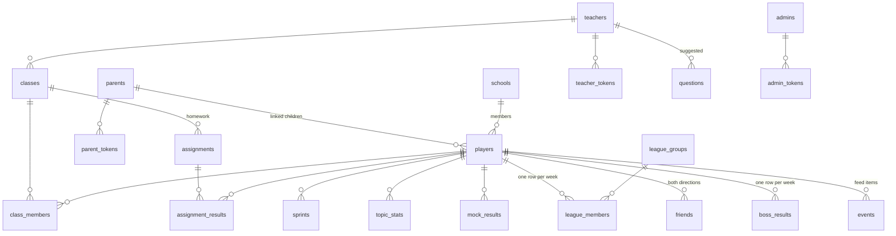

# Data model

The database is MySQL / MariaDB (InnoDB, `utf8mb4`), created from `api/schema.sql` and changed by the numbered files
in `api/migrations/`, applied in order by `php api/migrate.php` (which records each file in `schema_migrations`).
All times are stored in Kampala time (`+03:00`).

Much of a child's state is **not** in the database at all: stars per level, badges list, Brain Power, the try-again
box, recently seen questions and exact topic mastery live on the device (see [architecture](architecture.md#offline-first)).
The database holds what must be shared or survive a lost phone: XP, sprints, leagues, social links, topic summaries,
mocks and accounts.

## Relationships at a glance

## Tables

### Children and grown-ups

**`players`**: one child profile per device. Created by `POST /players`.

| Column | Purpose |
|---|---|
| `id` | Player id, sent as `X-Player-Id` |
| `device_id` (unique) | Random UUID made on the device; identifies the device on registration |
| `token_hash` | SHA-256 of the device's secret token |
| `name`, `avatar`, `grade` | First name or nickname, an animal emoji, class (TOP, P1–P7) |
| `xp_total` | Lifetime points |
| `tier` | League tier 0–4 (Bronze … Champion) |
| `is_demo` | 1 for pretend players made by `api/dev/seed-demo.php` (local testing only) |
| `last_seen_at`, `activity` | Last heartbeat and what they're playing (`maths:P5:hard`), for "playing now" |
| `day_streak`, `badges` | Copied from the device on each heartbeat, for player cards |
| `friend_code` (unique) | 6-character code, made the first time it's needed |
| `parent_id` → `parents` | Set when a parent links the child |
| `school_id` → `schools` | The school the child joined |

Why: a child needs no account, email or phone; the device *is* the account. A parent account is optional and only
links to it.

**`parents`**: phone (unique, `2567XXXXXXXX` form), name, `pin_hash` (bcrypt of the 4-digit PIN via
`password_hash`), `failed_logins` and `locked_until` (5 wrong PINs lock it for 15 minutes).
**`parent_tokens`**: hashed sign-in tokens with `last_used_at`.

**`teachers`**: name, phone (unique), `password_hash` (8+ characters), school name (free text), lock-out fields.
**`teacher_tokens`**: hashed tokens; accepted for 30 days.

**`admins`** / **`admin_tokens`**: staff accounts (made with `api/dev/create-admin.php`); tokens accepted for 12 hours,
expired ones deleted at each sign-in.

### Play

**`sprints`**: one row per finished sprint (normally 10 questions; 12 for a boss fight).
`subject`, `grade`, `level` (`simple`/`medium`/`hard`/`pro`, or `mixed` for practice and topic homework), `score`,
`correct`, `total`, `avg_ms`, `best_streak`, `played_at` (on the device), `created_at` (arrival).
Index `(player_id, played_at)` serves the duplicate check, the 15-second check and every per-child report.
Why one summary row and not one row per answer: it is all parents, teachers, cards and races need, and it is about
ten times smaller (see growth below).

**`topic_stats`**: one row per child + subject + class + topic: lifetime `correct`/`total` and the approximate recent
window `recent_correct`/`recent_total` (up to 20). An aggregate, updated in place, so it doesn't grow with play.
See [topic mastery](algorithms.md#5-topic-mastery).

**`mock_results`**: one row per PLE mock: class, correct, total, minutes used, per-topic counts (JSON), `taken_at`.

**`boss_results`**: best boss damage per child per week (`week_start`, `player_id` primary key), with class for the
per-class board.

### Leagues and social

**`league_groups`**: one row per group: `week_start` (a Monday), `grade`, `tier`, `size` (≤ 30). Index
`(week_start, grade, tier, size)` finds the fullest open group.

**`league_members`**: one row per child per week: `group_id` and this week's `xp`. Primary key
`(week_start, player_id)`; index `(group_id, xp)` for rankings. Last week's rows decide promotion and demotion, and
"this week's XP" everywhere (friends, schools, cards) is read from here.

**`events`**: the live feed: `kind` (`perfect`, `big_score`, `streak`, `race_win`, `promoted`, `boss`) and a short
text (≤ 120 characters) such as "got a perfect 10 in P5 Maths 💯". Admins can delete items.

**`friends`**: `(player_id, friend_id)`, stored **both ways** so "my friends" is one simple query. Max 50 per child.

**`schools`**: name, district (unique together), `status` (`pending` / `approved` / `hidden`), `created_by`.
Children can add schools; they stay out of public lists until an admin approves them
([decision 8](decisions.md#adr-008-moderation-pending-schools-and-a-name-word-filter)).

### Teachers and homework

**`classes`**: a teacher's class: name, class (TOP–P7), a unique 6-character join `code`. Up to 20 per teacher.
**`class_members`**: which children joined which class (max 3 classes per child).
**`assignments`**: homework: title, subject, *either* a `level` (a normal sprint) *or* a `topic` (a practice sprint
on that topic), `due_on`.
**`assignment_results`**: each child's best attempt per assignment (best = most correct).

### Competitions

**`papers`**: a paper built by the [Paper Engine](algorithms.md#15-paper-engine-server-marked-competitions):
`subject` (or `mixed`), `grade`, `questions` (JSON, **with** answers and working; only sent without them until the
results are out), `minutes`.
**`paper_attempts`**: one child's single go at a paper: `started_at` and `deadline` (server clock), `submitted_at`,
`picks` (JSON), `correct`, `seconds` (the tie-break), and `school_id` (the side they played for).
**`school_contests`**: school A challenges school B: `grade`, `subject`, `starts_at`–`ends_at` (the window),
`status` (`pending` / `accepted` / `declined` / `cancelled`; "expired", "upcoming", "live" and "finished" are worked
out from the times), `paper_id` (set on acceptance), who created and who answered.
**`duels`**: a child challenges a friend: `paper_id`, `challenger_id`, `opponent_id`, `grade`, `subject`, `status`
(`open` / `declined`), `expires_at` (48 hours).
**`weekly_challenges`**: the Weekly Challenge paper for each class each week: `week_start`, `grade` (together the
key), `paper_id`. Attempts are ordinary `paper_attempts`, with the child's school at the time.
Also: `teachers.school_id` (the school a teacher speaks for) and `schools.open_to_challenges`.

### Content

**`questions`**: the question bank. `subject`, `grade`, `level`, `topic`, `prompt`, `speak` (read-aloud text,
optional), `choices` (JSON array, 2–4), `answer`, `steps` (JSON array, optional), `status`
(`draft` / `approved` / `retired`), `source` (e.g. `admin:prombright`, `import:file.csv by …`, `teacher:Name`),
`teacher_id` (if a teacher suggested it), `review_note` (why it was sent back), `updated_at` (used as the cache
version). `image_url` exists but is not used yet. Only `approved` rows ever reach children.

**`fact_sets`** (`api/migrations/009_fact_engine.sql`): one table of facts for the
[Fact Engine](algorithms.md#14-fact-engine-fact-table-question-generation): `subject`, `name` (unique per subject;
also the topic name in reports), `grade_from`–`grade_to` (the classes it is taught in), `columns` (JSON, e.g.
`["organ","job","system"]`), `templates` (JSON question patterns), `explain` (the worked-step pattern), `status`
(`draft` / `approved` / `retired`), `source`, `updated_at` (set on every save, including edits to the facts alone, so
phones notice; it is the cache version).

**`facts`**: the rows of a fact set: `set_id`, `values` (JSON array in column order), `position`. Saving a set replaces
all its rows in one transaction.

### Website and money

**`leads`**: contact-form enquiries from the landing page: kind (school / parent / other), name, organisation,
phone, email, message, sender IP (for the 5-per-hour limit), status (new / contacted / closed).

**`subscriptions`** and **`payments`**: created in the first schema for Sprint Passes paid by MTN MoMo / Airtel
Money. **Not used by any code yet**; everything is free ([decision 4](decisions.md#adr-004-everything-free-for-now)).

**`schema_migrations`**: names of applied migration files.

## Who can see what

Children see only each other's *game* identity. Nothing that could locate or contact a child is ever shown to
another child.

| Data | Other children | Parent (own children) | Teacher (own class) | Admin |
|---|---|---|---|---|
| Name, avatar, class | yes (leagues, feed, cards, friends, schools) | yes | yes | yes |
| Lifetime and weekly XP, tier, day streak, badge count | yes | yes | lifetime XP | lifetime XP |
| Sprint count, overall accuracy, best streak | yes (player card) | per subject, this week, last 5 sprints | this week | no |
| Online now and what they're playing | yes | no | last seen time | last seen time |
| Feed items | yes | no | no | yes (can delete) |
| School | school name on boards | no | no | yes |
| Friend list | only their friends see them | no | no | no |
| Topic mastery, weak topics | no | top 3 weak / strong | weak topics, class topic table | no |
| Mock results, readiness | no | readiness | readiness | no |
| Homework results | no | no | yes | no |
| Device id, token, parent, phone numbers | **never** | own phone | own phone | parent link yes/no |

Approved bank questions (with answers) are public (`GET /questions`), by design: the game must download them without
signing in, and they are school material, not secrets.

## Storage growth

Rough sizes per row in InnoDB, including index entries and overhead:

| Table | Rows per active child per year | Bytes per row | Per child per year |
|---|---|---|---|
| `sprints` | ~1,500 (≈ 4 sprints a day) | ~100 | ~150 KB |
| `league_members` | 52 | ~60 | ~3 KB |
| `topic_stats` | ~30–60, updated in place (not per year) | ~100 | ~5 KB |
| `events`, `mock_results`, `boss_results`, homework | tens | 100–300 | ~10 KB |
| **Total** | | | **~0.2 MB** |

"Active" means playing most days; many registered children will play far less.

| Active children | Database growth per year |
|---|---|
| 1,000 | ~0.2 GB |
| 10,000 | ~2 GB |
| 100,000 | ~20 GB |

The `sprints` table is about three-quarters of it. If **per-answer** detail were ever stored (one row per question:
which question, which choice, how long), it would be about 10 rows per sprint, roughly 1.5–2 MB per active child per
year, or 150–200 GB a year at 100,000 children.

## Plan to scale

1. **Now (shared hosting, up to a few thousand active children):** the existing indexes cover the hot queries:
   `sprints (player_id, played_at)`, `league_members (group_id, xp)`, `league_groups (week_start, grade, tier, size)`,
   `players (last_seen_at)`, `events (created_at)`, `questions (subject, grade, level, status)`. Turn on automatic
   database backups in cPanel.
2. **Before ~10,000 active children:** move to a small VPS (more CPU and memory for MySQL, and control over its
   settings). Watch the slow-query log. Likely next steps: cache the school ranking and presence counts for a minute
   (they are recalculated on every request today), add an index on `sprints (played_at)` for the admin overview, and
   regularly delete old `events` and expired `parent_tokens` / `teacher_tokens` (nothing prunes them yet).
3. **Per-answer analytics, if ever added:** keep detailed answers only short-term (for example 30–90 days, or roll them
   up into `topic_stats`-style summaries), so the database stays small and the data kept about children is minimal.
4. **Much later:** old sprints (older than a year or two) can be summarised per child per week and the raw rows
   archived, since nothing in the app reads sprints older than "recent" except lifetime totals, which are already
   stored in `players.xp_total`.
